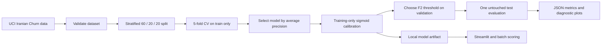

# Customer Churn Prediction

[](https://github.com/andres-olivera/customer-churn-prediction/actions/workflows/ci.yml)
[](https://github.com/andres-olivera/customer-churn-prediction/actions/workflows/publish-results.yml)

**An end-to-end machine learning project for telecom customer churn.**

**Python · scikit-learn · cross-validation · calibrated classification · Streamlit · GitHub Actions**

Built to show an analytical workflow beyond dashboarding: formulate a business problem, enforce data quality, prevent train/test leakage, compare multiple models, select a decision threshold, and report honest, reproducible performance.

> The dataset describes customer behavior across months 1–9 and whether the account churned by month 12. This is a three-month planning horizon, **not** a real-time forecast from live production data.

## Architecture



## Dataset

[UCI Iranian Churn (ID 563)](https://archive.ics.uci.edu/dataset/563/iranian+churn+dataset) — 3,150 customers from one telecom operator. Source data is licensed under **CC BY 4.0**; the software in this repository uses an MIT license. Original file is downloaded from UCI and intentionally excluded from Git. See [data provenance](data/README.md).

Our classifier uses 11 predictors including call failures, complaints, length of subscription, call/SMS usage and tariff. It **excludes** `Status` as a conservative leakage precaution and `Customer Value` because its derivation and availability are not documented in sufficient detail for inference.

## What is evaluated?

| Stage | Method |
| --- | --- |
| Split | Stratified 60% training / 20% validation / 20% **untouched test** |
| Models | Logistic regression, random forest, histogram gradient boosting |
| Reference | Constant-prior dummy classifier |
| Model selection | Training-only 5-fold CV, maximize average precision |
| Calibration | 3-fold sigmoid calibration on training only |
| Threshold selection | Maximize F2 on validation, emphasizing recall |
| Test metrics | ROC-AUC, average precision, precision, recall, F2, Brier score, confusion matrix |
| Interpretation | Permutation importance on the locked test set (descriptive, not causal) |

All training transformations are estimated within CV folds. Test data is not used to choose the algorithm or threshold.

## Results

**Measured reports (generated by the reproducible experiment):**

- [Experiment summary](reports/EXPERIMENT.md) — human-readable, versioned once training succeeds.
- [Full performance and cross-validation comparison](reports/metrics.json).
- [Diagnostic figures](reports/figures).

Reports are published by the [Verified experiment workflow](.github/workflows/publish-results.yml) after downloading and validating the original source, running tests, fitting models, and generating charts. **No placeholder metric values** are presented as empirical findings. If links above are missing, the real-data experiment has not yet published successfully.

## Local quick start

Requires Python 3.11 or 3.12, with commands run from the repository root:

```bash
git clone https://github.com/andres-olivera/customer-churn-prediction.git
cd customer-churn-prediction
python -m venv .venv
# Windows PowerShell: .venv\Scripts\Activate.ps1
# macOS/Linux: source .venv/bin/activate
python -m pip install --upgrade pip
pip install -e ".[dev,app]"
pytest -q
python scripts/download_data.py
python scripts/train.py
python scripts/figures.py
python scripts/summarize_results.py
streamlit run app/streamlit_app.py
```

To score a CSV with the 11 documented feature columns:

```bash
python scripts/score_batch.py path/to/new_customers.csv --out reports/batch_predictions.csv
```

Run `python scripts/train.py --fast` only for a quicker engineering check; use the **default full procedure** for portfolio results.

## Repository structure

```text
├── .github/workflows/         CI and verified real-data evaluation
├── app/streamlit_app.py       Single-customer risk exploration
├── data/README.md            Source provenance and licensing
├── docs/                     Methodology, business case, model card
├── scripts/                  Download, train, report, batch score
├── src/churn_prediction/     Reusable modeling and data modules
├── tests/                    Unit and end-to-end synthetic tests
├── reports/                  Verified results generated by workflow
└── pyproject.toml            Reproducible Python project metadata
```

## Responsible use and limitations

This is a **portfolio prototype**, not an operational system. A random split of a single historic operator dataset cannot establish future generalization, validate demographic fairness, measure retention campaign uplift, or determine incremental profit. Age and age-group fields require a legal and fairness review before real-world customer decisions. Predictor importance is not causal. Serialized joblib files should never be opened from untrusted sources.

See [methodology](docs/METHODOLOGY.md), [model card](docs/MODEL_CARD.md) and [business framing](docs/BUSINESS_CASE.md).

**Author:** Andrés Olivera Domínguez · [GitHub profile](https://github.com/andres-olivera)
