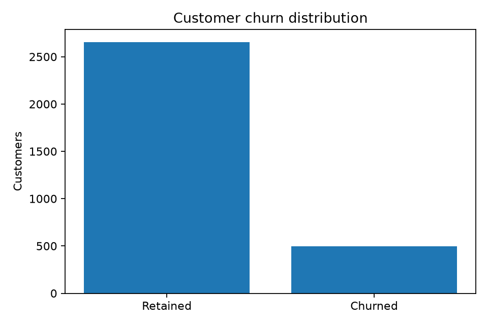
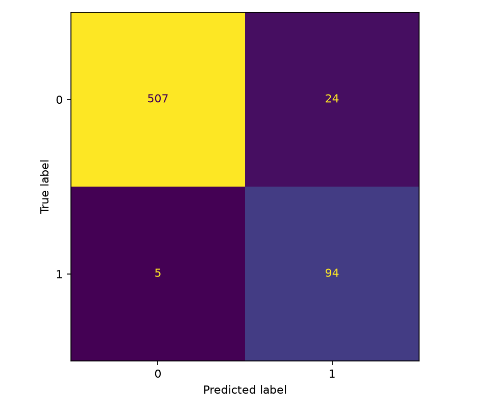
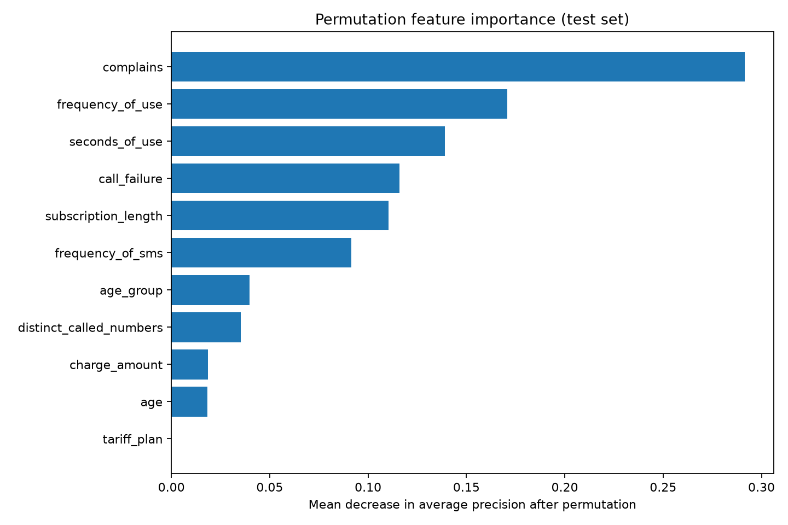

# Verified churn experiment results

> Automatically generated by scripts/summarize_results.py from reports/metrics.json.
> Values come from a real-data training run, not hypothetical examples.

- Dataset: UCI Iranian Churn (ID 563)
- Seed: 42
- Total customers: **3,150**
- Training / validation / test: 1890 / 630 / 630
- Full sample churn prevalence: 15.7%
- Selected model: **hist_gradient_boosting**
- Tuned validation F2 threshold: **0.27**

## Final untouched test evaluation

| Metric | Selected model | Dummy prior reference |
| --- | ---: | ---: |
| Average precision | 0.9411 | 0.1571 |
| ROC-AUC | 0.9878 | 0.5000 |
| Precision at threshold | 0.7966 | 0.0000 |
| Recall at threshold | 0.9495 | 0.0000 |
| F2 at threshold | 0.9144 | 0.0000 |
| Accuracy | 0.9540 | 0.8429 |
| Brier score (lower is better) | 0.0331 | 0.1324 |

Test confusion matrix [[TN, FP], [FN, TP]]: `[[507, 24], [5, 94]]`.

## Candidate comparison (training-only five-fold CV)

| Model | Mean average precision | SD | Mean ROC-AUC |
| --- | ---: | ---: | ---: |
| hist_gradient_boosting | 0.9015 | 0.0222 | 0.9740 |
| random_forest | 0.8623 | 0.0200 | 0.9690 |
| logistic_regression | 0.7539 | 0.0466 | 0.9285 |
| dummy | 0.1571 | 0.0013 | 0.5000 |

## Diagnostics

## Limitations

Retrospective random holdout on one historical operator; no validation against
future cohorts, demographic fairness, campaign uplift or production drift.
The threshold was chosen to optimize validation F2, not retention ROI.
Permutation importance is descriptive and cannot establish causality.
